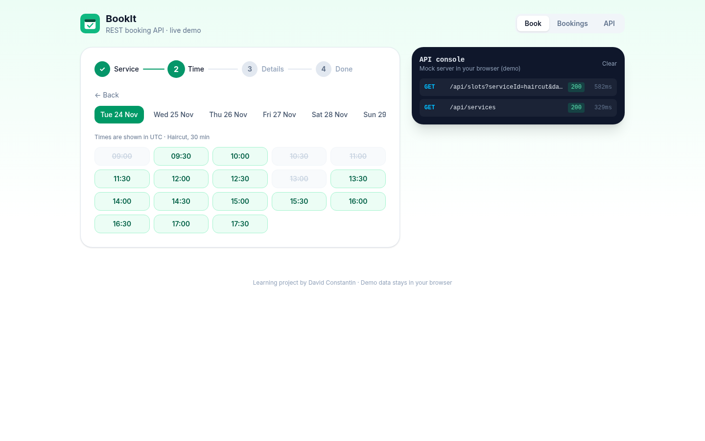
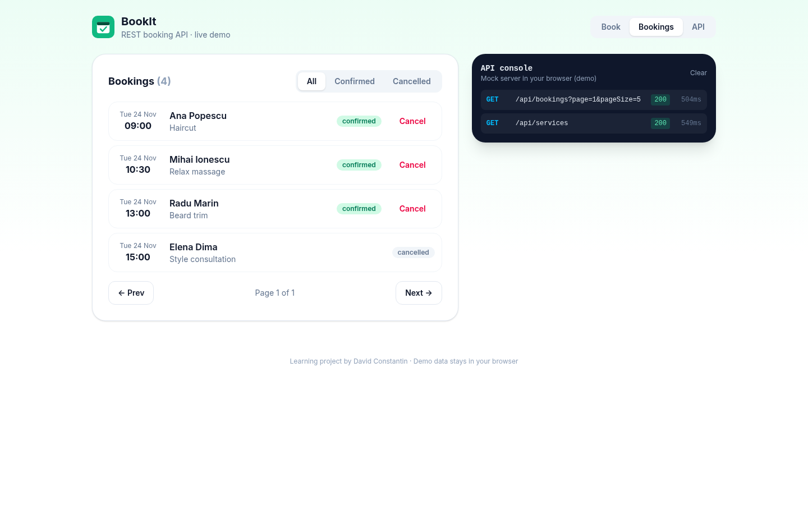
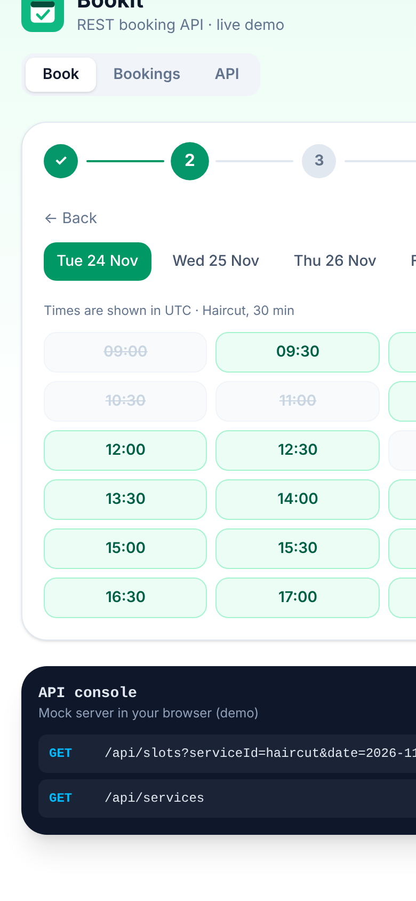

# BookIt — REST Booking API + Live Demo

A REST API for booking appointments (think: a small barber shop), built with **Node.js, Express 5, TypeScript, Zod and PostgreSQL**, with automated tests and OpenAPI docs.
The repository also contains an animated **React** front-end that demonstrates the API.

> Learning project #4 in my roadmap. The businesses and bookings are fictional demo data.

**Live demo (front-end + in-browser mock API):** https://davidgeorgeconstantin-spec.github.io/bookit-api/

| Booking flow | Bookings list | Mobile |
|---|---|---|
|  |  |  |

## How the demo works

GitHub Pages can only host static files, so the live demo uses a **mock server that runs in your browser** (`src/api/mockServer.ts`).
It implements the same routes, validation rules and status codes as the real Express server and stores data in `localStorage`.
The **API console** on the right shows every request and response (method, path, status, timing, JSON).

To use the real server instead, run it locally and start the front-end with `VITE_API_URL=http://localhost:4000`.

## API (`/server`)

| Method | Route | Description |
|---|---|---|
| GET | `/api/health` | Health check |
| GET | `/api/services` | List services |
| GET | `/api/slots?serviceId&date` | Free / taken slots for a day |
| GET | `/api/bookings?page&pageSize&status&date` | Paginated, filterable list |
| GET | `/api/bookings/:id` | One booking |
| POST | `/api/bookings` | Create — `400` invalid, `404` unknown service, `409` overlap, `422` closed/past |
| PATCH | `/api/bookings/:id/cancel` | Cancel |
| GET | `/docs` | Swagger UI (OpenAPI 3) |

**Server features**

- Express 5 with async route handlers and one central **error middleware** (consistent JSON errors)
- **Zod** validation for bodies and query strings
- **Repository pattern**: routes depend on an interface; `memoryRepository` (default, tests) or `postgresRepository` (when `DATABASE_URL` is set)
- Parameterized SQL queries (no SQL injection), schema + seed in `server/db/schema.sql`
- Overlap detection, opening hours, pagination
- **10 integration tests** with Vitest + Supertest, run in CI (`.github/workflows/server-tests.yml`)

```bash
cd server
npm install
npm run dev          # http://localhost:4000, docs at /docs (in-memory store)
npm test             # Vitest + Supertest
npm run build && npm start
```

With PostgreSQL (free tier on [Supabase](https://supabase.com) or [Neon](https://neon.tech)):

```bash
cp .env.example .env       # set DATABASE_URL
npm run db:migrate         # creates tables + seed services (needs psql)
npm run dev
```

Free hosting for the server: [Render](https://render.com) free web service (root directory `server`, build `npm install && npm run build`, start `npm start`).

## Front-end features

- Multi-step booking wizard (service → time → details → done) with direction-aware slide transitions
- Client-side validation with Zod (same rules as the server) + shake animation on errors
- Slot grid with staggered entrance, shared-layout day picker, skeleton loaders
- Bookings list with filter tabs, pagination, optimistic layout animations on cancel
- Animated success check (SVG `pathLength`) + confetti
- Live **API console** built on `useSyncExternalStore`
- TanStack Query for caching and cache invalidation after mutations
- Respects `prefers-reduced-motion`

## Tech stack

**Server:** Node.js · Express 5 · TypeScript · Zod · pg (PostgreSQL) · Vitest · Supertest · OpenAPI/Swagger UI
**Client:** React 19 · TypeScript · Vite · TanStack Query · Tailwind CSS 4 · Motion · ESLint

## Project structure

```
├── server/                      # real REST API
│   ├── src/
│   │   ├── app.ts               # createApp(repo): middleware + routes
│   │   ├── index.ts             # picks memory or Postgres repository
│   │   ├── routes/              # services.ts, bookings.ts
│   │   ├── domain/              # types, Zod schemas, slot logic, HttpError
│   │   ├── repositories/        # interface + memory + Postgres implementations
│   │   ├── middleware/          # errorHandler, notFound
│   │   └── docs/openapi.ts      # OpenAPI spec + Swagger UI page
│   ├── tests/bookings.test.ts
│   └── db/schema.sql
└── src/                         # React demo
    ├── api/                     # client.ts, mockServer.ts, requestLog.ts, bookings.ts
    ├── features/                # booking/ (wizard), bookings/, console/, docs/
    ├── components/ui/           # Button, Tabs, Skeleton
    ├── hooks/useBookingApi.ts   # queries + mutations
    ├── lib/                     # format, motion presets, cn
    └── types/api.ts
```

## Front-end scripts

```bash
npm install
npm run dev
npm run lint
npm run build
```

`.github/workflows/deploy.yml` publishes the front-end to GitHub Pages (Settings → Pages → Source: **GitHub Actions**).

## Author

**David Constantin** · [GitHub](https://github.com/davidgeorgeconstantin-spec)
